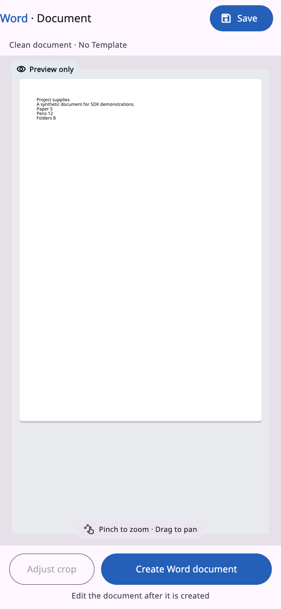
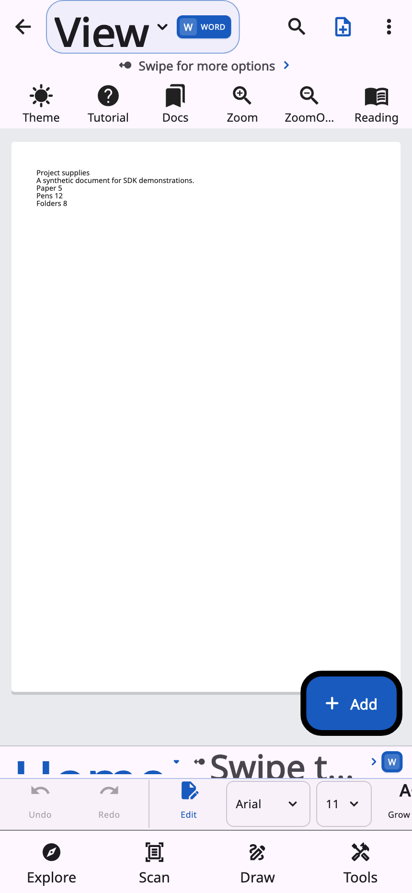

# AresWord screenshots

These images are rendered from the actual SDK Flutter widgets at 430 × 932
logical pixels (2× PNG output) using synthetic text and table data. The harness
substitutes readable Noto fonts for unavailable system fonts. Native licence
verification is mocked only in the private screenshot harness. No real capture,
customer document, licence token or owner entitlement is pictured.

## Scan review

The domain review screen shown after recognition. The camera is not running.

## Editor

The domain editor opens a generated synthetic Office document. These images
describe the current source UI and do not certify native customer artifacts,
physical-device capture, admin-mode operation, or full Microsoft feature parity.
